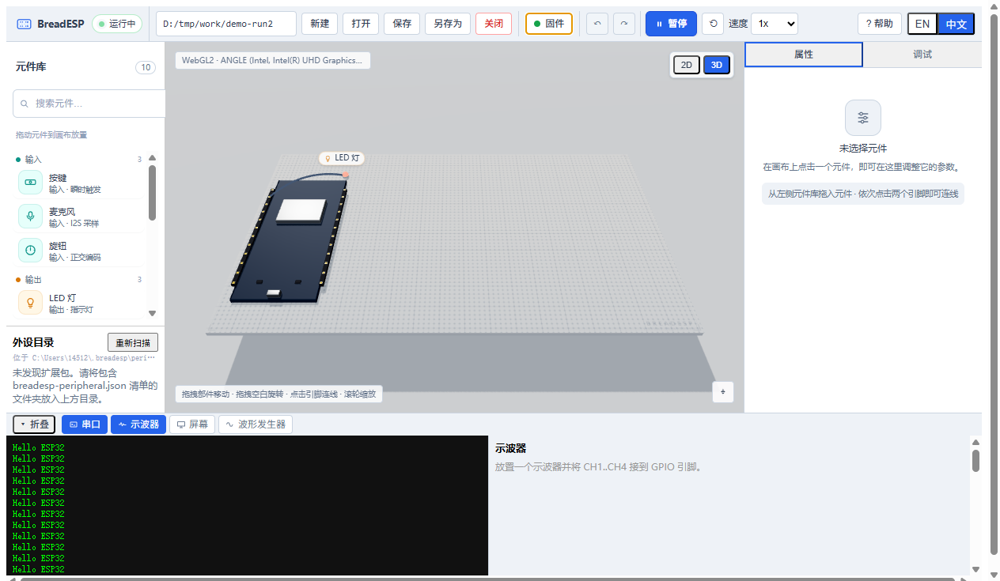
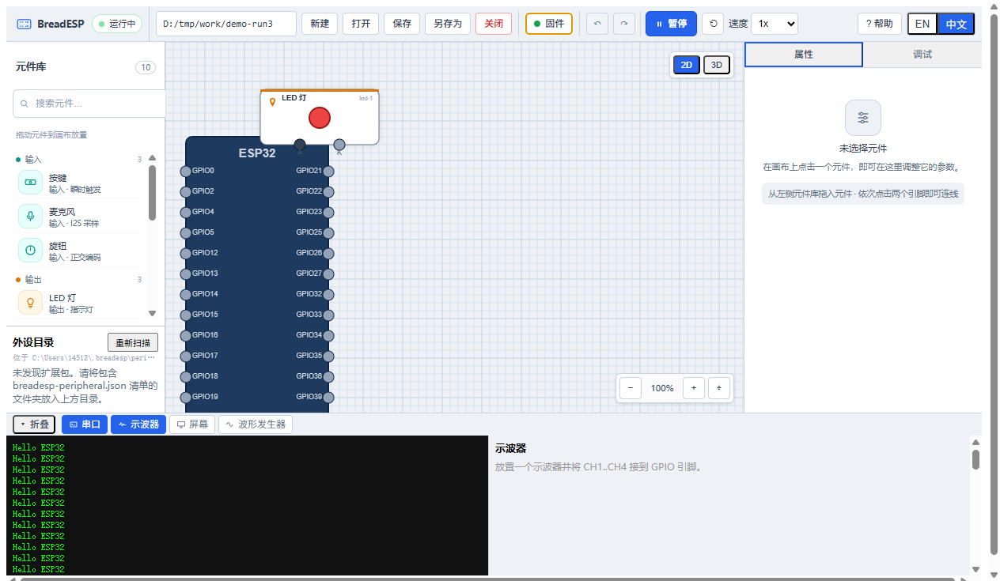

# BreadESP — ESP32 Virtual Breadboard Simulator

**English** | [简体中文](docs/README.zh-CN.md)

> A local-first functional simulator for the ESP32: build circuits graphically, run real firmware,
> debug with GDB and watch the serial console — the whole loop stays offline.
> This repository is **generated entirely by AI** (PRD-driven development). MIT License.



The main window at a glance: the left column is the parts panel (built-in palette plus the local
peripheral directory), the centre is the breadboard canvas (drop parts, wire pin to pin, and the MCU
node exposes every usable GPIO of the selected chip), the right side is the debug panel, and the
bottom row holds the serial console, screen view, oscilloscope and waveform generator.



The blink example project: an LED on GPIO2 while the simulation runs, with the serial console
printing the firmware's `Hello ESP32` in real time.

## Features

- **Virtual breadboard**: drag to place parts, wire pin to pin, delete and clear, undo/redo (20 steps);
  the netlist (logic) and the layout (visual) persist separately; save / open / save-as projects.
- **3D modelled view**: the same board switches between 2D and 3D; every part has a recognisable
  procedural 3D model, with drag-to-rotate camera, drag-to-move parts (grid snapping), in-3D pin
  wiring and live state (LED glow, screen contents, microphone LIVE) — sharing one netlist and
  layout with 2D.
- **Real simulation**: QEMU-ESP32 executes real Xtensa firmware for ESP32 / ESP32-S3 / ESP32-C3 / ESP32-C6;
  the logical clock scales from 0.1x to 10x.
- **Debugging**: GDB breakpoints (function / address / conditional / hardware watchpoints), stepping,
  variables and registers; a DAP adapter plugs the same session into VS Code.
- **Serial**: live UART0 output (ANSI-aware), and you can inject input into the firmware.
- **Built-in peripherals**: LED, push button, SSD1306 OLED, ST7789 TFT, buzzer, speaker (I2S),
  microphone (I2S / waveform injection), rotary knob, SHT30 temperature and humidity, oscilloscope.
- **Peripheral SDK**: third parties register new peripherals as standalone packages loaded from local
  directories; the `pnpm create-peripheral` scaffold generates a publishable package in one step.
- **Project linking**: link a PlatformIO / ESP-IDF project directory as a whole, and `build/*.elf` is
  discovered and imported automatically.
- **Offline docs site**: `pnpm docs:build` produces a bilingual static docs site (zero external assets,
  works disconnected) with six step-by-step tutorials in Chinese and English.

## Quick start

### Option 1: Installer (Windows, recommended)

Download `BreadESP-Setup-*.exe` from [GitHub Releases](https://github.com/keroroyuki/BreadESP/releases/latest)
and double-click to install — the installer bundles the breadesp-dbus device build of QEMU and the
example firmware, so **no Node.js and no repository clone are needed**.

Run your first project in 30 seconds: create a project (blink-led template) → import the example
`blink.elf` from the "Firmware" panel at the top → press "Run"; the LED blinks with the firmware and
the serial console prints `Hello ESP32`.

### Option 2: Run from source

Requirements: **Node.js ≥ 22.12**, **pnpm ≥ 9**; Windows / macOS / Linux.

```bash
pnpm install       # install workspace dependencies
pnpm fetch-qemu    # download the QEMU-ESP32 binaries on demand (SHA-256 verified, not committed)
pnpm dev           # launch the app (vite dev server + Electron)
```

Then follow the tutorials for your first project (from creating it to the LED blinking with the firmware):

- [01 · Getting started](docs/en/tutorials/01-getting-started.md) — install, launch and a UI tour
- [02 · First project: a blinking LED](docs/en/tutorials/02-first-project.md) — create a project, wire it, import firmware, run the simulation

The repository ships deterministic golden firmware (`packages/sim-core/fixtures/`, e.g. `blink.elf`,
which prints `Hello ESP32` and toggles GPIO2), so the whole flow works without an ESP-IDF toolchain.

### Platform notes

The simulation core has two tiers, prepared as needed:

| Capability | What you need | How to get it |
|---|---|---|
| Firmware execution, serial, GDB debugging, project management | Regular QEMU-ESP32 | Bundled in the installer; from source: `pnpm fetch-qemu` (all platforms) |
| Peripheral bus interaction (LED on/off, OLED rendering, button injection, ...) | breadesp-dbus device build of QEMU | Bundled in the installer; from source: `node scripts/build-qemu-device.mjs` (Docker for the Linux build, MSYS2/UCRT64 for the Windows build — see §Development) |
| Breakpoint debugging | `xtensa-esp32-elf-gdb` (esp-gdb 17.x) | ESP-IDF toolchain; point `BREADESP_GDB_BIN` at it |

## Development

Common commands:

| Command | What it does |
|---|---|
| `pnpm dev` | Dev mode: vite dev server + Electron main process (orchestrated by `scripts/dev.mjs`) |
| `pnpm build` | Build everything (tsc for the lib packages → dist, shell tsc, ui tsc + vite) |
| `pnpm test` | vitest across the repository (e2e tests that need real QEMU/GDB are gated by env vars and skipped when the binaries are missing) |
| `pnpm typecheck` | TypeScript strict check across the repository |
| `pnpm docs:build` / `docs:serve` / `docs:check` | Build / preview / link-check the offline docs site |
| `pnpm --filter @breadesp/<pkg> test` | Test a single package |

Test-gating environment variables: `BREADESP_QEMU_BIN` (regular QEMU), `BREADESP_QEMU_DBUS_BIN`
(device build), `BREADESP_GDB_BIN` (GDB). When unset, the related e2e tests are skipped rather than failed.

Package layout (pnpm monorepo, six layered packages):

| Package | Responsibility |
|---|---|
| `packages/ui` | React renderer (breadboard, debug panel, serial, screen, oscilloscope) |
| `packages/shell` | Electron main process / bridge (QEMU, GDB, peripheral management, IPC) |
| `packages/peripherals` | Peripheral device models (run inside the bridge) |
| `packages/netlist` | Netlist schema, validation and project templates |
| `packages/sim-core` | QEMU argument construction, ELF parsing and validation, dbus device C sources, golden firmware |
| `packages/docs-site` | Offline docs-site builder |

Data flow: the UI edits the netlist → IPC → the bridge rebuilds peripheral instances and routing →
QEMU executes the firmware → bus transactions are forwarded back to the bridge through the dbus
device → peripheral models update → render snapshots are pushed back to the UI. See
[docs/architecture.md](docs/architecture.md) for details.

## Documentation

Source docs are authored in Chinese; every page below has an English mirror under [`docs/en/`](docs/en/PRD.md), and the offline docs site ships both languages with a switcher.

- [PRD.md](PRD.md) — single source of truth (requirements, interface contracts, directory conventions) · [EN](docs/en/PRD.md)
- [docs/dev-plan.md](docs/dev-plan.md) — development plan, milestones, code style, commit conventions · [EN](docs/en/dev-plan.md)
- `docs/test-plan.md` — test approach and current status (not part of the docs-site page set)
- [docs/architecture.md](docs/architecture.md) — architecture deep dive · [EN](docs/en/architecture.md)
- [docs/peripheral-sdk.md](docs/peripheral-sdk.md) — peripheral SDK guide · [EN](docs/en/peripheral-sdk.md)
- [docs/dap.md](docs/dap.md) — DAP adapter (VS Code debugging) · [EN](docs/en/dap.md)
- [docs/tutorials/](docs/tutorials/01-getting-started.md) — step-by-step tutorials (getting started, first project, debugging, peripheral reference, authoring peripherals, VS Code) · [EN](docs/en/tutorials/01-getting-started.md)
- [CHANGELOG.md](CHANGELOG.md) — changelog · [EN](docs/en/CHANGELOG.md)

## Contributing

`main` is protected: any change — features, bug fixes, docs — must come from a branch off `main` and
land through a PR; direct pushes are rejected.

1. `git switch -c feat/ui-3d-snap` (from the latest `main`)
2. Commit messages follow Conventional Commits; local hooks are installed by `pnpm install`
3. Push and open a PR: **the PR title becomes the squashed commit message**, and the `verify` CI job must be green
4. Squash merge; the branch is deleted automatically

See `CONTRIBUTING.md` and [docs/dev-plan.md](docs/dev-plan.md) §6 (branch and release workflow) for details.

## AI agent conventions (PRD §10)

- Read the relevant PRD section before changing code, and tag file headers with `// PRD: §X.Y`.
- Do not introduce runtime dependencies that are not listed in PRD §5; interface changes (PRD §6) must stay backward compatible.
- Files MUST live under the paths in PRD §7; do not commit binaries (QEMU is fetched by `scripts/fetch-qemu.mjs`).

## License

MIT — see [LICENSE](LICENSE).
